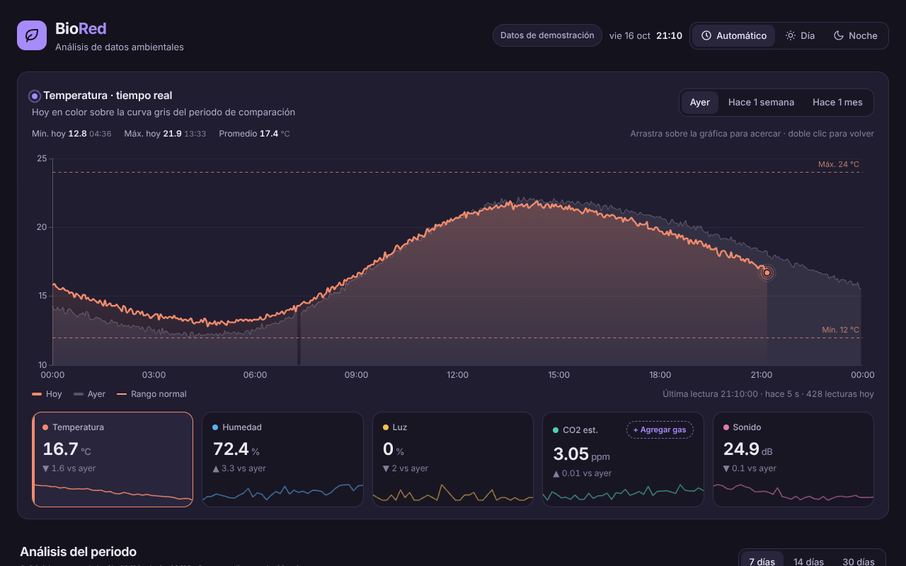
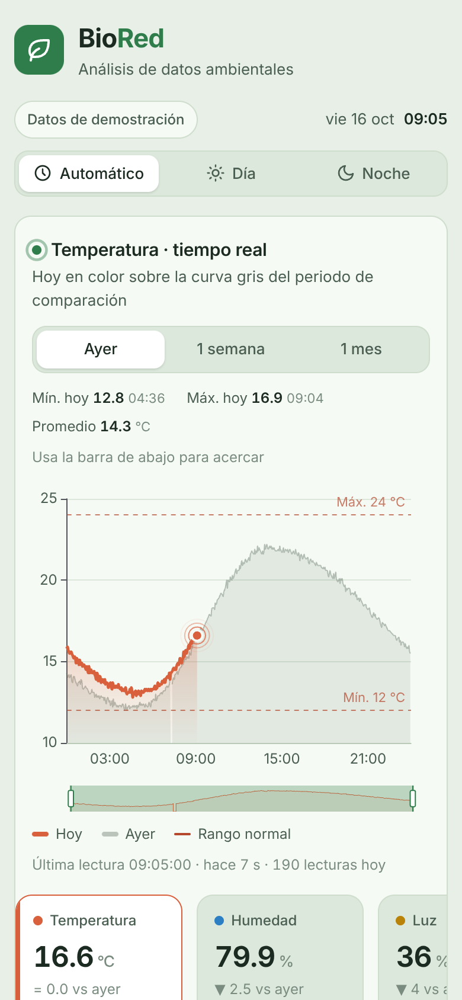
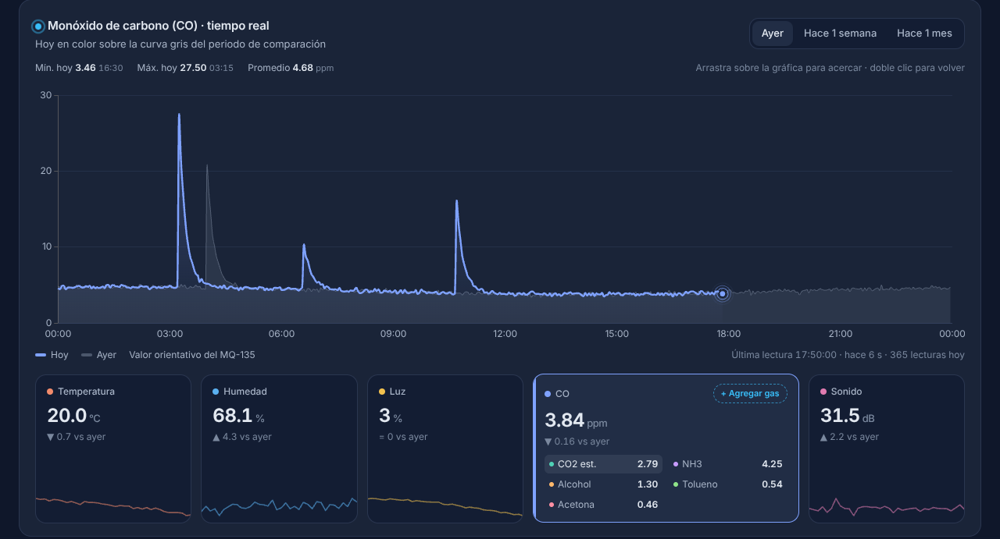
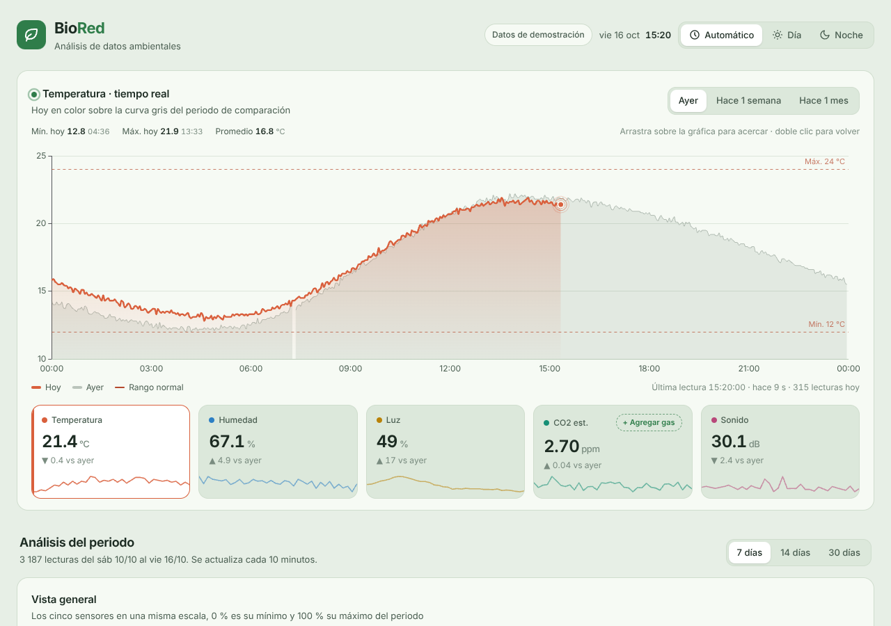
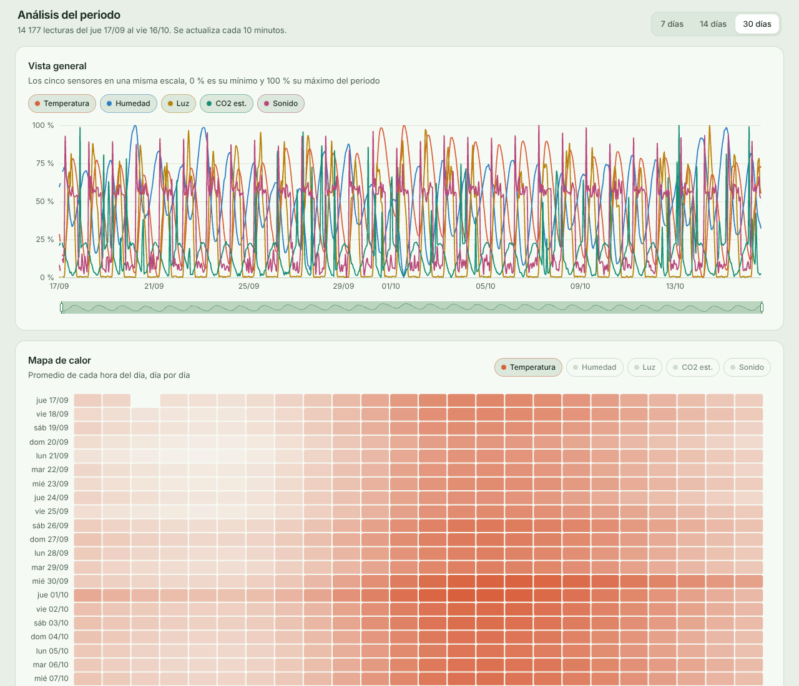
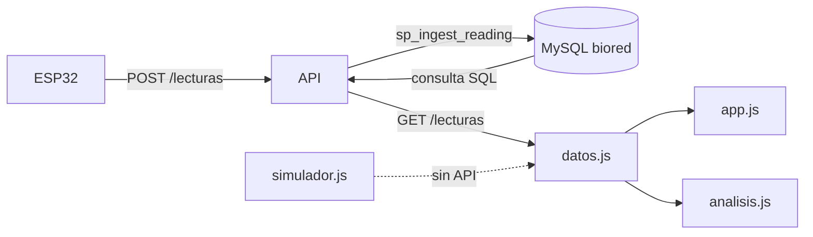

# BioRed · Módulo de análisis de datos v2

Módulo web que muestra en tiempo real las lecturas de la estación ambiental BioRed y las compara con días anteriores. También analiza el comportamiento de las variables en los últimos 7, 14 o 30 días con estadísticas, gráficas y hallazgos escritos de forma automática.



- **Tecnología.** HTML, CSS y JavaScript puro con [Apache ECharts](https://echarts.apache.org) 6.0.0. No usa plantillas ni frameworks, no necesita compilación y funciona sin internet.
- **Datos.** Mientras la API no esté lista usa un simulador con el mismo formato que entregará la API. Para pasar a datos reales solo se cambia una línea de `js/config.js`.
- **Variables.** Temperatura, humedad relativa, luz, CO2 estimado y nivel de sonido. Desde la tarjeta de gases se pueden agregar CO, NH3, alcohol, tolueno y acetona.
- **Estación.** MAC `80:B5:4E:C7:50:94`.

## Contenido

1. [Cómo abrirlo](#cómo-abrirlo)
2. [Qué muestra](#qué-muestra)
3. [Contrato con la API](#contrato-con-la-api)
4. [Cómo validar la API con el módulo](#cómo-validar-la-api-con-el-módulo)
5. [Configuración](#configuración)
6. [Estructura del proyecto](#estructura-del-proyecto)
7. [Cómo se calcula cada cosa](#cómo-se-calcula-cada-cosa)
8. [Pruebas](#pruebas)
9. [Subir al repositorio](#subir-al-repositorio)
10. [Limitaciones y pendientes](#limitaciones-y-pendientes)

## Cómo abrirlo

**En el computador.** Doble clic en `index.html`. Se abre en Chrome, Edge o Firefox sin instalar nada.

**Desde un celular en la misma red Wi-Fi.** Copiar la carpeta completa a `C:\xampp\htdocs\`, encender Apache en el panel de XAMPP y abrir `http://IP-DEL-PC/BioRed_Analisis_v2/` en el celular. La IP del PC se consulta con `ipconfig` en la línea "Dirección IPv4". El Firewall de Windows debe permitir Apache en redes privadas.



**Con un enlace público.** Activar GitHub Pages en el repositorio (Settings, Pages, rama `main`, carpeta raíz). El módulo queda en `https://USUARIO.github.io/REPOSITORIO/BioRed_Analisis_v2/`. GitHub Pages gratuito solo funciona con repositorios públicos.

**En el servidor.** Copiar la carpeta a una ruta que sirva Nginx. Si el módulo y la API quedan en el mismo dominio no hace falta configurar CORS.

## Qué muestra

### Panel en tiempo real

| Elemento | Qué hace |
|---|---|
| **Gráfico principal** | La curva de hoy en color sobre la curva gris del periodo de comparación (ayer, hace 1 semana o hace 1 mes). El punto que late marca la última lectura |
| **Tooltip comparativo** | Al pasar el mouse muestra la hora, el valor de hoy, el del periodo elegido, la diferencia y si el valor está fuera del rango normal |
| **Zoom** | En el computador se arrastra sobre la gráfica para acercar y doble clic para volver. En pantallas táctiles aparece una barra debajo de la gráfica |
| **Resumen del día** | Mínimo y máximo de hoy con su hora, además del promedio |
| **Tarjetas** | Valor actual, diferencia contra el periodo elegido y una minigráfica de las últimas 3 horas. Tocar una tarjeta cambia el sensor del gráfico principal |
| **Alertas** | Insignia "Alto" o "Bajo" cuando el valor sale del rango normal y aviso "Sensor sin responder" cuando el DHT22 o el micrófono fallan |
| **Estado en vivo** | Hora de la última lectura y tiempo transcurrido. Se pone en color de alerta si dejan de llegar datos |

### Tarjeta de gases del MQ-135

Por defecto muestra solo el CO2. El botón **+ Agregar gas** abre un menú para sumar CO, NH3, alcohol, tolueno y acetona. Los gases agregados aparecen en una lista compacta dentro de la misma tarjeta. Al tocar uno pasa al gráfico principal. El navegador recuerda la elección.

Todas las estimaciones salen de la misma resistencia del sensor (`rs_kohm`) con curvas distintas del datasheet. Por eso suben y bajan juntas y no entran al análisis del periodo, donde repetirían la misma información que el CO2.



### Paletas por franja horaria

| Franja | Paleta |
|---|---|
| 06:30 a 17:29 | Bosque claro |
| 05:30 a 06:29 y 17:30 a 18:29 | Grafito azul |
| 18:30 a 05:29 | Medianoche violeta |

 

El botón **Automático** sigue la hora del dispositivo. **Día** y **Noche** fijan una paleta y el navegador recuerda la elección.

### Análisis del periodo

Se elige entre los últimos 7, 14 o 30 días y se recalcula cada 10 minutos.

| Sección | Qué responde |
|---|---|
| **Vista general** | Los cinco sensores en una misma escala de 0 a 100 %, con un punto por hora. Cada sensor se puede ocultar |
| **Mapa de calor** | Promedio de cada hora del día, día por día, para la variable elegida |
| **Lo que muestran los datos** | Hallazgos escritos sobre el ciclo diario, las tendencias, las relaciones entre variables, la calidad de los datos y los periodos sin datos |
| **Resumen estadístico** | Lecturas, porcentaje de válidas, mínimo, P25, mediana, media, P75, máximo y desviación estándar |
| **Correlaciones** | Coeficiente de Pearson entre cada par de variables. Al hacer clic en una celda se muestra esa relación |
| **Relación entre dos variables** | Dispersión con recta de regresión, r, R² y la pendiente explicada en palabras |



## Contrato con la API

> Esta sección es la guía para construir la API. El módulo solo **lee** datos. La escritura la hace el ESP32 con el endpoint de ingesta.

### Endpoints

| Método | Ruta | Quién lo usa | Qué hace |
|---|---|---|---|
| `POST` | `/lecturas` | ESP32 | Recibe una lectura y la guarda con `CALL sp_ingest_reading(json, @reading_id)` |
| `GET` | `/lecturas` | Este módulo | Devuelve las lecturas de una estación entre dos fechas |

El formato del `POST`, las reglas de validación y los mensajes de error del procedimiento están en el README de `BioRed_DB_v3`. Lo recomendable es que el `POST` responda `201` con `{ "reading_id": 123 }` y que los errores `SQLSTATE 45000` del procedimiento se devuelvan como `400` con su mensaje.

### GET /lecturas

```
GET {apiUrl}/lecturas?device_uid=80:B5:4E:C7:50:94&desde=2026-10-16 00:00:00&hasta=2026-10-16 23:59:59
```

| Parámetro | Formato | Descripción |
|---|---|---|
| `device_uid` | MAC en mayúsculas | Estación a consultar |
| `desde` | `AAAA-MM-DD HH:MM:SS` | Inicio del rango, incluido |
| `hasta` | `AAAA-MM-DD HH:MM:SS` | Fin del rango, incluido |

Los parámetros llegan codificados en la URL (el espacio como `%20` y los dos puntos como `%3A`). Cualquier framework los decodifica de forma automática.

**Respuesta `200`**

```json
{
  "device_uid": "80:B5:4E:C7:50:94",
  "lecturas": [
    {
      "reading_id": 1,
      "received_at": "2026-10-16 00:00:00",
      "temperature_c": 16.9,
      "humidity_pct": 76.5,
      "dht_valid": true,
      "light_pct": 0,
      "co2_ppm": 3.34,
      "co_ppm": 4.92,
      "nh3_ppm": 4.97,
      "alcohol_ppm": 1.58,
      "toluene_ppm": 0.67,
      "acetone_ppm": 0.56,
      "sound_db": 24.8,
      "audio_valid": true
    }
  ]
}
```

### Campos de cada lectura

| Campo | Tipo | Origen en la base | Llega en `null` cuando |
|---|---|---|---|
| `reading_id` | entero | `readings.id` | Nunca |
| `received_at` | texto `AAAA-MM-DD HH:MM:SS` | `readings.received_at` | Nunca |
| `temperature_c` | decimal | `temperature_readings.value_c` | El DHT22 falló o no envió datos |
| `humidity_pct` | decimal | `humidity_readings.value_pct` | El DHT22 falló o no envió datos |
| `dht_valid` | booleano o 0/1 | `temperature_readings.is_valid` | No llegó la sección del DHT22 |
| `light_pct` | entero de 0 a 100 | `light_readings.percentage` | No llegó la sección del LDR |
| `co2_ppm` | decimal | `gas_estimates.ppm` con `gas = 'CO2'` | El MQ-135 estaba calentando o no envió datos |
| `co_ppm` | decimal | `gas_estimates.ppm` con `gas = 'CO'` | Igual que el CO2 |
| `nh3_ppm` | decimal | `gas_estimates.ppm` con `gas = 'NH3'` | Igual que el CO2 |
| `alcohol_ppm` | decimal | `gas_estimates.ppm` con `gas = 'ALCOHOL'` | Igual que el CO2 |
| `toluene_ppm` | decimal | `gas_estimates.ppm` con `gas = 'TOLUENE'` | Igual que el CO2 |
| `acetone_ppm` | decimal | `gas_estimates.ppm` con `gas = 'ACETONE'` | Igual que el CO2 |
| `sound_db` | decimal | `audio_readings.level_db` | No llegó la sección de audio |
| `audio_valid` | booleano o 0/1 | `audio_readings.is_valid` | No llegó la sección de audio |

### Reglas de la respuesta

1. Una fila por lectura, en orden ascendente de `received_at`.
2. Las fechas van en la hora local de Colombia (`America/Bogota`). El módulo interpreta `received_at` con la hora del navegador, así que el servidor debe usar esa misma zona horaria o la API debe convertirla antes de responder.
3. Si no hay lecturas en el rango, responder `200` con `"lecturas": []`.
4. Las banderas pueden llegar como `true` y `false` o como `1` y `0`. Los números pueden llegar como número o como texto (MySQL entrega los `DECIMAL` como texto). El módulo acepta ambas formas.
5. Si una lectura llega con `dht_valid` o `audio_valid` en falso, el módulo descarta esos valores aunque traigan número.
6. Errores. `400` si falta un parámetro o una fecha no tiene el formato, `404` si la estación no existe y `500` para fallas del servidor. El módulo muestra el código del error en pantalla.
7. Si el módulo se publica en un dominio distinto al de la API, la API debe enviar la cabecera `Access-Control-Allow-Origin` con el dominio del módulo (o `*` mientras se prueba).

### Cuántos datos pide el módulo

| Momento | Rango que pide | Filas aproximadas con envíos cada 3 minutos |
|---|---|---|
| Al abrir la página | Hoy, desde las 00:00 hasta ahora | Hasta 480 |
| Al elegir ayer, 1 semana o 1 mes | Un día completo | 480 |
| En vivo, cada `intervaloActualizacionS` | Desde la última lectura que tiene hasta ahora | 0 o 1 |
| Análisis del periodo, al abrir y cada 10 minutos | Últimos 7, 14 o 30 días | 3 360, 6 720 o 14 400 |

La consulta de 30 días es la más pesada. El índice `idx_readings_station_time` del script 01 la mantiene rápida. Si la API la sirve comprimida con gzip, la respuesta baja de unos 4 MB a cerca de 0.3 MB.

### Consulta SQL de referencia

Arma una fila por lectura con todos los campos del contrato. Los gases se unen una vez por cada gas, aprovechando la llave primaria `(reading_id, gas)` de `gas_estimates`.

```sql
SELECT r.id                                            AS reading_id,
       DATE_FORMAT(r.received_at, '%Y-%m-%d %H:%i:%s') AS received_at,
       t.value_c                                       AS temperature_c,
       h.value_pct                                     AS humidity_pct,
       t.is_valid                                      AS dht_valid,
       l.percentage                                    AS light_pct,
       g_co2.ppm                                       AS co2_ppm,
       g_co.ppm                                        AS co_ppm,
       g_nh3.ppm                                       AS nh3_ppm,
       g_alc.ppm                                       AS alcohol_ppm,
       g_tol.ppm                                       AS toluene_ppm,
       g_ace.ppm                                       AS acetone_ppm,
       a.level_db                                      AS sound_db,
       a.is_valid                                      AS audio_valid
  FROM readings r
  JOIN stations s                  ON s.id = r.station_id
  LEFT JOIN temperature_readings t ON t.reading_id = r.id
  LEFT JOIN humidity_readings h    ON h.reading_id = r.id
  LEFT JOIN light_readings l       ON l.reading_id = r.id
  LEFT JOIN gas_estimates g_co2    ON g_co2.reading_id = r.id AND g_co2.gas = 'CO2'
  LEFT JOIN gas_estimates g_co     ON g_co.reading_id  = r.id AND g_co.gas  = 'CO'
  LEFT JOIN gas_estimates g_nh3    ON g_nh3.reading_id = r.id AND g_nh3.gas = 'NH3'
  LEFT JOIN gas_estimates g_alc    ON g_alc.reading_id = r.id AND g_alc.gas = 'ALCOHOL'
  LEFT JOIN gas_estimates g_tol    ON g_tol.reading_id = r.id AND g_tol.gas = 'TOLUENE'
  LEFT JOIN gas_estimates g_ace    ON g_ace.reading_id = r.id AND g_ace.gas = 'ACETONE'
  LEFT JOIN audio_readings a       ON a.reading_id = r.id
 WHERE s.device_uid = ?
   AND r.received_at BETWEEN ? AND ?
 ORDER BY r.received_at;
```

Los `?` se reemplazan con parámetros preparados (`device_uid`, `desde`, `hasta`) y nunca concatenando texto, para evitar inyección SQL. La API debe conectarse con el usuario `biored_app`, que solo puede leer e insertar.

## Cómo validar la API con el módulo

**1. Probar la consulta con el set de pruebas de la base.** Después de ejecutar los scripts 01 a 05 de `BioRed_DB_v3` (sin el 07), la fila del caso P01 debe salir así.

| Campo | Valor esperado |
|---|---|
| `temperature_c` | 21.6 |
| `humidity_pct` | 69.5 |
| `dht_valid` | 1 |
| `light_pct` | 29 |
| `co2_ppm` | 2.83 |
| `co_ppm` | 3.91 |
| `nh3_ppm` | 4.30 |
| `alcohol_ppm` | 1.31 |
| `toluene_ppm` | 0.54 |
| `acetone_ppm` | 0.46 |
| `sound_db` | 35.7 |
| `audio_valid` | 1 |

En el caso P03 (MQ-135 en calentamiento) los seis gases deben llegar en `null`. En el P05 (solo DHT22) todo debe llegar en `null` salvo temperatura, humedad y `dht_valid`.

**2. Comparar la respuesta con un ejemplo generado por el módulo.** Desde esta carpeta se genera una respuesta de ejemplo con el formato exacto que espera el módulo.

```bash
node herramientas/exportar_json.js 7
```

Crea `datos/respuesta_api_7_dias.json`. La respuesta de la API debe tener los mismos campos y tipos.

**3. Conectar el módulo a la API.** En `js/config.js` cambiar `apiUrl: null` por la dirección base de la API, por ejemplo `apiUrl: 'http://192.168.1.50/api'`. Luego subir `intervaloActualizacionS` al intervalo real de envío del ESP32 (por ejemplo `60` o `180`). Al abrir `index.html`, la insignia del encabezado debe decir "Datos de la API". Si algo falla, el mensaje aparece debajo del gráfico principal. La pestaña **Red** de las herramientas del navegador (F12) muestra la URL pedida y la respuesta.

## Configuración

Todo se ajusta en `js/config.js`.

| Opción | Para qué sirve |
|---|---|
| `apiUrl` | Dirección base de la API. En `null` usa el simulador |
| `deviceUid` | MAC de la estación que se consulta |
| `intervaloActualizacionS` | Segundos entre consultas de lecturas nuevas. 15 en pruebas, el intervalo del ESP32 con datos reales |
| `variables` | Variables del panel y del análisis, con nombre, unidad, decimales, bandera de validez y rango normal |
| `gases` | Gases que se pueden agregar desde la tarjeta del MQ-135 |

Los rangos normales actuales son de prueba (temperatura de 12 a 24 °C, humedad de 40 a 90 %, CO2 hasta 6 ppm y sonido hasta 42 dB). El semillero debe definirlos según el sitio donde quede instalada la estación.

## Estructura del proyecto

```
BioRed_Analisis_v2/
├── index.html                  interfaz
├── css/
│   ├── estilos.css             diseño, paletas y versión para celular
│   └── fuente.css              fuente Inter incrustada
├── js/
│   ├── config.js               API, estación, variables y gases
│   ├── tema.js                 paletas por franja horaria
│   ├── simulador.js            estación simulada con fallas a propósito
│   ├── datos.js                adaptador de datos (API o simulador)
│   ├── serie.js                utilidades del gráfico principal y las tarjetas
│   ├── estadisticas.js         cálculos estadísticos (de la v1)
│   ├── interpretacion.js       hallazgos escritos (de la v1)
│   ├── agregados.js            vista general, mapa de calor y matriz de correlación
│   ├── app.js                  panel en tiempo real
│   └── analisis.js             análisis del periodo
├── herramientas/
│   └── exportar_json.js        respuesta de ejemplo de la API
├── pruebas/                    pruebas automáticas con Node.js
├── capturas/                   imágenes de este README
└── vendor/                     ECharts 6.0.0 y licencias
```



`datos.js` es la única parte que sabe de dónde vienen los datos. El resto del módulo no cambia al pasar del simulador a la API.

## Cómo se calcula cada cosa

- **Lecturas válidas.** Si `dht_valid` o `audio_valid` vienen en falso, esos valores se descartan antes de cualquier cálculo.
- **Comparación con el pasado.** Ayer es el día anterior, hace 1 semana es el mismo día de la semana anterior y hace 1 mes es la misma fecha del mes anterior. Las tarjetas comparan contra la lectura de esa fecha más cercana a la misma hora, con una tolerancia de 10 minutos.
- **Huecos.** Si pasan más de 10 minutos entre dos lecturas, la línea se corta en lugar de unir los puntos.
- **Vista general.** Promedio por hora de cada variable, llevado a 0 % (mínimo del periodo) y 100 % (máximo del periodo).
- **Desviación estándar.** Muestral, dividiendo entre n − 1.
- **Percentiles y mediana.** Interpolación lineal entre los dos valores más cercanos.
- **Tendencia entre días.** Recta de regresión sobre los promedios diarios. Se reporta solo si R² es de 0.5 o más y hay al menos 3 días.
- **Correlación.** Pearson, con las lecturas en las que ambas variables tienen dato. Fuerte desde 0.7, moderada desde 0.4 y débil desde 0.2, en valor absoluto.
- **Gases del MQ-135.** El simulador usa las curvas `ppm = a · (Rs/R0)^b` de la librería MQUnifiedsensor, las mismas del script 04 de la base de datos.

## Pruebas

Con Node.js instalado, desde esta carpeta.

```bash
node pruebas/tema.test.js
node pruebas/datos.test.js
node pruebas/serie.test.js
node pruebas/analisis.test.js
```

| Archivo | Pruebas | Qué revisa |
|---|---|---|
| `tema.test.js` | 19 | Franjas horarias, próximo cambio de paleta y modo manual |
| `datos.test.js` | 18 | Simulador, adaptador, lecturas en vivo sin repetir y curvas de gases contra el caso P01 |
| `serie.test.js` | 17 | Cortes por huecos, búsquedas por hora, resumen del día, minigráficas, alertas y ejes |
| `analisis.test.js` | 15 | Vista general, mapa de calor, matriz de correlación y hallazgos sobre datos simulados |

Las 69 pruebas deben terminar con "0 fallan".

## Subir al repositorio

La carpeta trae un `.gitignore` que deja por fuera las capturas de cada fase de desarrollo y las respuestas de ejemplo generadas. Desde la raíz del repositorio local.

```bash
git status
git add BioRed_Analisis_v2
git commit -m "Modulo de analisis v2 con panel en tiempo real, gases del MQ-135 y contrato de la API"
git push
```

Antes del `commit`, revisar con `git status` que solo aparezcan archivos de `BioRed_Analisis_v2`.

## Limitaciones y pendientes

- Usa datos simulados hasta que la API esté lista.
- Las estimaciones del MQ-135 son orientativas y el sonido está en decibeles relativos a 1 mV, no en dB SPL.
- Los rangos normales son de prueba y deben definirse con el semillero.
- La API todavía no tiene autenticación. Antes de publicarla en internet conviene agregar un token por estación para el `POST` y limitar el `GET` a los dominios del proyecto.

## Licencias de terceros

- [Apache ECharts](https://echarts.apache.org) 6.0.0, licencia Apache 2.0 (`vendor/echarts-LICENSE.txt`).
- [Inter](https://rsms.me/inter/), licencia SIL Open Font License 1.1 (`vendor/inter-LICENSE.txt`).
